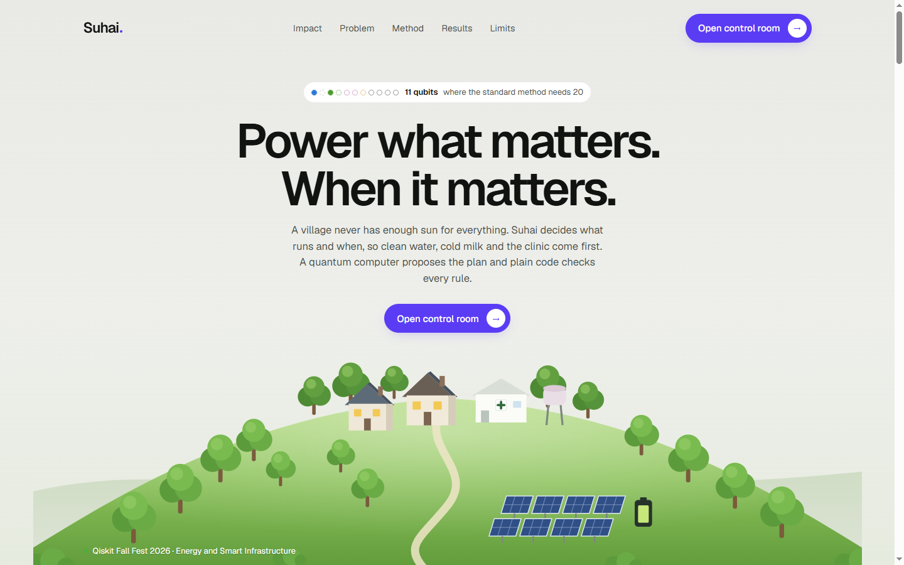
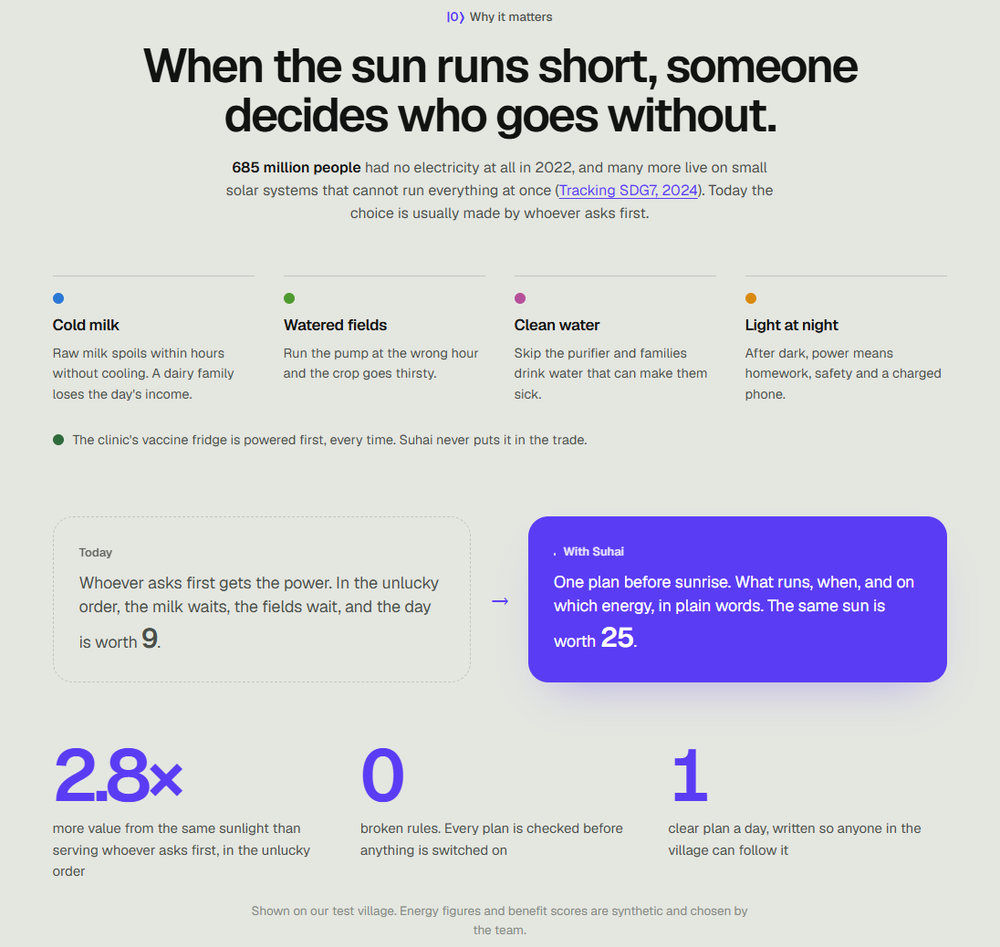
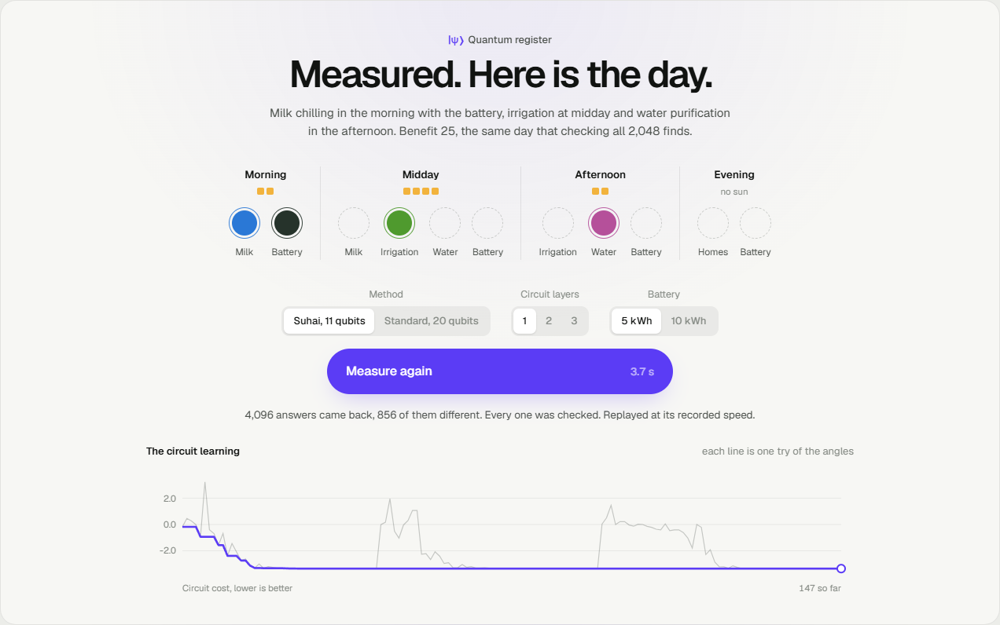
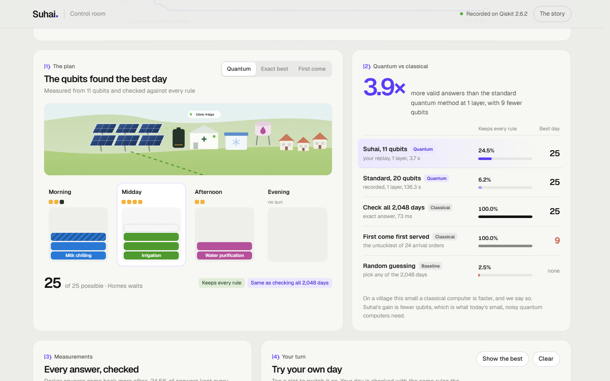
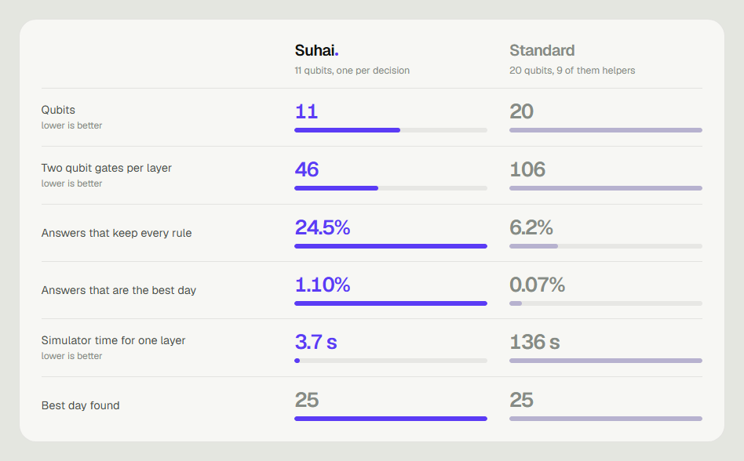
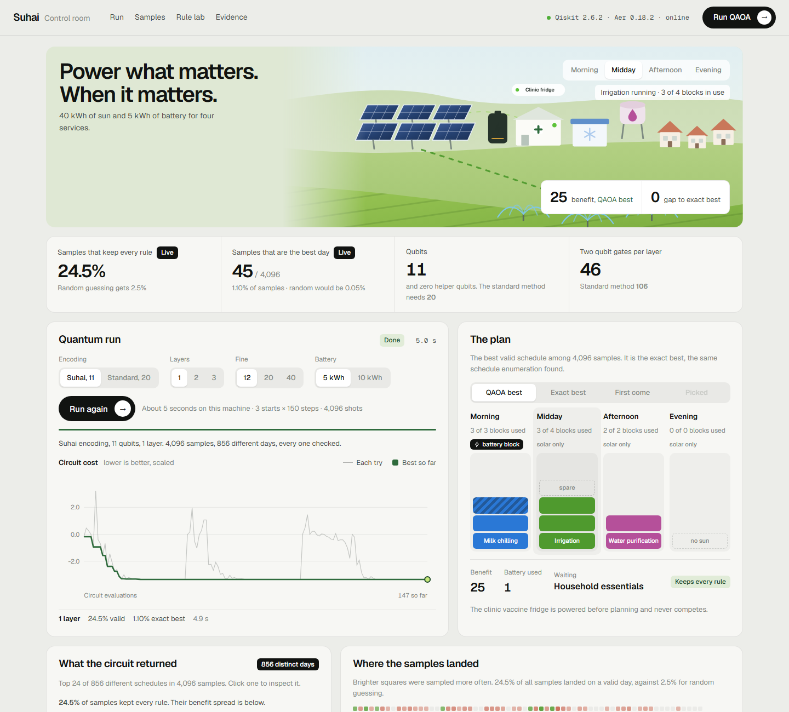

<div align="center">

# Suhai

### Power what matters. When it matters.

**[Open the live site](https://suhai-tan.vercel.app)**  ·  **[Watch 11 qubits plan a day](https://suhai-tan.vercel.app/app)**

</div>



Six in the morning. The milk is fresh, and it has only a few hours to get cold.
By noon the fields are dry. After dark a child needs light to do homework.
The solar panels on the roof cannot do all of it, and the battery holds one small block.

Somebody has to choose. Today it is usually whoever asks first.

**Suhai makes that choice well.** It turns the day into 11 yes or no questions,
lets a quantum computer weigh all 2,048 possible days at once, checks every
answer against the rules, and hands back one plan anyone can follow.
The clinic's vaccine fridge is never part of the trade. It is always on.

<table>
<tr>
<td align="center" width="25%"><h2>2.8×</h2>more value from the same sunlight than serving whoever asks first</td>
<td align="center" width="25%"><h2>11</h2>qubits, where the usual method needs 20</td>
<td align="center" width="25%"><h2>3.9×</h2>more valid answers from the circuit on the same budget</td>
<td align="center" width="25%"><h2>0</h2>broken rules in the plan we hand over</td>
</tr>
</table>

## The village

685 million people had no electricity at all in 2022
([Tracking SDG7, 2024](https://www.worldbank.org/en/news/press-release/2024/06/11/progress-on-basic-energy-access-reverses-for-first-time-in-a-decade)).
Many more live on a small solar system that cannot run everything at once.

Our village gets 40 kWh of sun in a day, most of it at midday and none after dark, plus a 5 kWh battery.
Four services want that energy: milk chilling, irrigation, water purification and household light.
Served in the unlucky order, the day is worth 9. Planned well, the same sunlight is worth 25.



## How it decides

Every circle below is a qubit, and every qubit is one real decision, such as
"run irrigation at midday" or "use the battery in the morning".
Before they are measured they flicker, because every possible day is still open.
After measurement they settle into a plan.



Here the qubits chose milk in the morning with the battery, irrigation at midday
and water purification in the afternoon. Benefit 25. It is the same day you find
by checking all 2,048 options one by one, and no rule is broken.



## Fewer qubits, same answer

The usual way to put an energy limit on qubits adds helper qubits that only count spare energy.
For this village that is 9 helpers, 20 qubits in total.

Suhai lists the 16 smallest combinations that break a rule, such as milk chilling twice,
or irrigation in the afternoon without the battery, and fines each one directly.
No helpers. Every qubit is a decision.



Measured on our recorded run (Qiskit 2.6.2, Aer statevector simulator, fixed seeds),
both methods with the same optimiser budget of 3 starting points and 150 steps per layer.

| | Standard, 20 qubits | Suhai, 11 qubits |
| --- | --- | --- |
| Helper qubits | 9 | **0** |
| Two qubit gates per layer | 106 | **46** |
| Circuit depth per layer | 60 | **55** |
| Answers that keep every rule, 1 layer | 6.2% | **24.5%** |
| Answers that keep every rule, 2 layers | 10.0% | **52.6%** |
| Answers that are the exact best, 2 layers | 0.24% | **3.12%** |
| Simulator time, 1 layer | 136 s | **3.7 s** |
| Best day found | 25 | 25 |

* Checking all 2,048 days gives the exact best, 25. Only 52 days keep every rule.
* At 1, 2 and 3 layers Suhai keeps 24.5%, 52.6% and 69.8% of its answers valid, and its best answer is the exact best every time.
* Random guessing keeps 2.5% valid. First come first served scores between 9 and 25 across all 24 arrival orders.
* With a 10 kWh battery the best day rises to 28 and homes get evening light. The circuit finds that day too.

On a village this small a normal computer checks every day faster, and we say so plainly.
There is no quantum speedup here. What Suhai shows is the same answer from fewer qubits and fewer gates,
which is exactly what today's small, noisy quantum computers need.

## Project map

| Part | Where |
| --- | --- |
| The problem, its rules and the test village | [live site](https://suhai-tan.vercel.app), `data/sample_scenario.json`, `src/model.py` |
| The 11 qubit model and its 16 fines | `src/encode_compact.py`, `src/encoding.py` |
| The usual 20 qubit model, for comparison | `src/encode_slack.py` |
| QAOA in Qiskit | `src/qaoa_solver.py` |
| Checking every answer, exact baseline | `src/decoder.py`, `src/classical_solver.py` |
| Every number in this file, reproduced | `run_all.py`, `results/` |
| 34 automated checks | `tests/` |
| The live control room | [suhai-tan.vercel.app/app](https://suhai-tan.vercel.app/app), `server/`, `web/` |

## Setup

Python 3.10 or newer.

```
python -m venv .venv
source .venv/bin/activate        # Windows: .venv\Scripts\activate
pip install -r requirements.txt
```

## See it live (web app)

```
python serve.py                  # opens http://127.0.0.1:8000
```

| Page | What it does |
| --- | --- |
| `/` | The story. The village day, the 2,048 possible schedules, the encoding, the proof, and what we do not claim |
| `/app` | The control room. Runs QAOA live in Qiskit and streams every optimiser step to the browser |
| `/app?autorun` | Same, and starts a run as soon as the page loads. Handy on stage |
| `/docs` | Every API route, documented and runnable |

The web app adds no new solver. Every route calls the same functions in `src/`
that produced the report, so the dashboard and the report cannot disagree.
Shortcuts in the control room: `R` run, `Esc` stop, `1` to `4` time of day,
`B` battery size, `E` encoding.



## Put it online (Vercel)

The hosted copy is a static site, so it loads from the CDN with no cold start.
Vercel cannot run Qiskit inside a request, so the same Python code writes
everything ahead of time:

```
python build_static.py           # writes web/data/, records all 10 QAOA runs (about 20 minutes)
python build_static.py --no-runs # data only, keeps the runs already recorded
```

Then import the repository in Vercel. `vercel.json` does the rest: no build
step, `web/` is served as is, `/app` works without `.html`, and `/api/health`
points at `web/data/health.json` so the page knows it is the hosted copy.
`.vercelignore` uploads only `web/`.

On the hosted copy everything the browser checks is real. Schedules are scored
from the table Python wrote, and `tests/test_static.py` proves it matches Python
on all 4,096 schedules. QAOA runs are real Qiskit Aer runs, recorded once and
replayed step by step with their own timings. The page says so. For live runs on
stage, use `python serve.py`. The same pages then talk to Qiskit directly.

## Reproduce every result

```
python -m pytest tests -q        # 34 checks (18 core, 12 web API, 4 hosted copy), about 50 seconds
python run_all.py                # all tables and charts, about 10 minutes
python run_all.py --quick        # skips the slow 20 qubit runs, about 4 minutes
```

Outputs are written to `results/`:

| File | Content |
| --- | --- |
| `summary.md` | All result tables |
| `results.json` | Every number, machine readable |
| `architecture.png` | Architecture diagram |
| `encoding_cost.png` | Qubits and circuit size, both encodings |
| `quality_comparison.png` | Valid share and best answer share, both encodings |
| `depth_study.png` | Suhai encoding at 1, 2 and 3 QAOA layers |
| `fcfs_orders.png` | First come first served over all arrival orders |
| `timetable.png` | Best valid schedule sampled by QAOA |
| `timetable_whatif.png` | Same with a 10 kWh battery |

Random seeds are fixed. Small differences between machines are normal.

## Code map

| File | Job |
| --- | --- |
| `data/sample_scenario.json` | The test instance (synthetic values) |
| `src/model.py` | Choices, rules, scoring |
| `src/classical_solver.py` | Exact enumeration and first come first served |
| `src/encoding.py` | Cost formula as a polynomial, and its conversion to a qubit operator |
| `src/encode_compact.py` | Suhai encoding, 11 qubits |
| `src/encode_slack.py` | Standard encoding, 20 qubits |
| `src/qaoa_solver.py` | QAOA circuit, angle tuning, sampling |
| `src/decoder.py` | Validates and scores sampled schedules |
| `src/figures.py` | Charts and architecture diagram |
| `run_all.py` | One command that reproduces everything |
| `serve.py` | Starts the web app |
| `build_static.py` | Writes `web/data/` for the hosted copy and records the QAOA runs |
| `vercel.json`, `.vercelignore` | Hosting setup, static only |
| `server/engine.py` | Reshapes answers from `src/` for the browser, runs live QAOA jobs on a worker thread |
| `server/app.py` | FastAPI routes, request checks, live progress stream (server sent events) |
| `web/` | Story page and control room. Plain HTML, CSS and JavaScript, no build step |
| `web/assets/js/api.js` | Talks to the live server, or to `web/data/` on the hosted copy |
| `tests/test_server.py` | Proves the API returns the same answers as the report |
| `tests/test_static.py` | Proves the hosted copy says exactly what the live server says |

## Honest limitations

* The instance is tiny. Exact enumeration solves it instantly. We claim no quantum speedup.
* All input values are synthetic. Benefit scores are human value judgments.
* The battery is simplified: already charged, used in whole blocks, no wear.
* The Suhai encoding grows quickly if many services can share one slot.
* Two of its fines involve three choices at once, so it is a QUBO plus two higher order terms.
* Results come from an ideal simulator. Real hardware noise would lower quality.

## Credits

* Qiskit and Qiskit Aer (IBM), NumPy, SciPy, Matplotlib.
* Web app: FastAPI and Uvicorn. Font from Google Fonts (Geist).
  Charts and the village illustration are hand written SVG, no chart library.
* No tutorial code was copied. Development was assisted by an AI coding
  assistant. All code was reviewed and run by the team.
